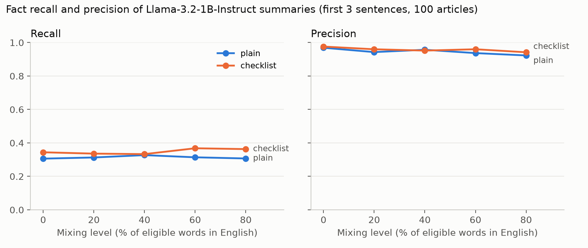
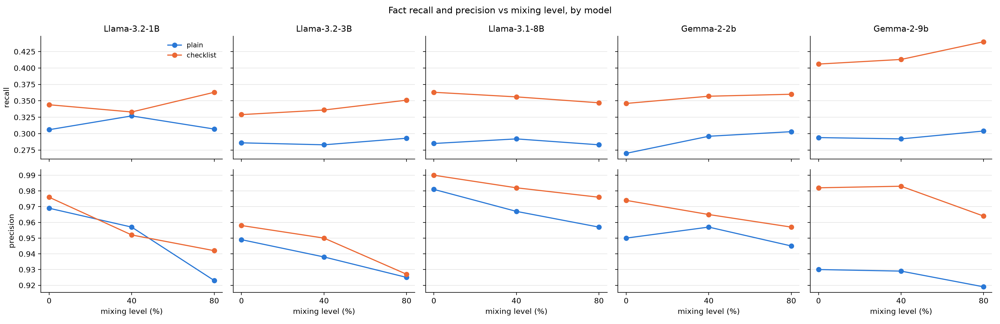

# FactIndic: Do code-mixed inputs make LLM summaries lose or invent facts?

*Final version (Day 5). Result numbers in section 3 come from `results/metrics.csv`; error-tag counts in section 5 come from `results/error_tag_counts.csv`, checklist-quality counts from `results/checklist_check.csv`; stretch numbers in section 6 come from `results/stretch_metrics.csv` and `results/scale/size_stretch_diffs.csv`; model-size and Gemma numbers in sections 7 and 8 come from `results/scale/size_metrics.csv`, `size_stretch_metrics.csv`, `size_stretch_diffs.csv` and `size_mixing_diffs.csv`; NLI numbers in section 9 come from `results/nli_validation.csv`, `nli_metrics.csv` and `nli_diffs.csv`; ROUGE and BERTScore numbers in section 10 come from `results/content_metrics.csv` and `content_diffs.csv`. All intervals are paired 95% bootstrap intervals over the 100 articles (2,000 resamples, seeded).*

## Summary of findings

- **Setup.** 100 BBC Hindi news articles (XL-Sum), made progressively code-mixed with English (0-80% of eligible nouns and adjectives; up to 18.6% of all words). Summarised by five open LLMs (Llama 3.2 1B/3B, Llama 3.1 8B, Gemma 2 2B/9B) with a plain prompt and a fact-checklist prompt: 5,400 summaries in all.
- **Facts are not lost, but wrong facts increase.** Fact recall stays flat with mixing for every model (0.27-0.33 with the plain prompt). Unsupported facts per summary rise with mixing for all three Llama models (Llama 1B 0.16 -> 0.38; +0.22, 95% interval 0.07 to 0.39) but not clearly for Gemma 2.
- **Bigger helps, but is not immune.** Llama 8B makes far fewer wrong facts (0.06 per summary unmixed) yet mixing still roughly triples them. Llama 3B is no better than 1B.
- **The fact-checklist prompt raises recall at every level for every model** (up to +0.14 for Gemma 2 9B) and improves number recall most (Llama 1B at level 80: 0.49 vs 0.33). Best combination: Gemma 2 9B with the checklist, F1 0.56-0.58.
- **English fact words hurt most.** Switching the fact words themselves to English (stretch) costs Llama 1B 0.044 recall and 0.053 precision against random mixing of the same number of words; the checklist prompt closes most of that gap. Most of the precision loss is names respelled in Devanagari, not invented facts.
- **Meaning check (NLI).** An automatic sentence-level entailment check agrees moderately with the hand tags (AUC 0.74). It shows mixing doubles summaries with a contradicted sentence for Llama 1B (19% -> 41%), not clearly for larger models. The checklist adds facts but does not fix who-did-what errors.
- **Content vs human summaries (ROUGE/BERTScore).** Unmixed, all models beat the Lead-3 baseline on ROUGE-1 (0.27-0.30 vs 0.26). Mixing lowers ROUGE-1 clearly for Llama 1B and 3B (-0.03) and not clearly for the rest; the checklist prompt does not change ROUGE.
- **Main error type in hand tags:** entity and role swaps (right names, wrong roles), which string-matching metrics cannot see.

## 1. Question

As Hindi news text becomes more code-mixed with English, do LLM summaries lose facts or gain wrong ones? And does adding an automatically extracted fact checklist to the prompt help?

## 2. Method

**Data.** We used 100 articles from the Hindi test split of XL-Sum (BBC Hindi). We kept articles of 150-600 words (6,414 of 8,847 qualify) and drew 100 of them with a fixed seed.

**Fact checklist.** For each original article we extracted names, places and organisations with IndicNER, and numbers and dates with regular expressions (Western and Devanagari digits). On average a checklist holds 13.5 entities, 2.5 numbers and 0.3 dates. 34 articles have no numbers and 82 have no dates.

**Code-mixing.** At level L, L% of the *eligible* words in an article are replaced by an English word in Latin script, for example "इस decision के बाद वे अपने prisoner बनाए जाने को courts में चुनौती दे सकते हैं".
- **Eligible words** are nouns and adjectives that are not part of any checklist fact and have a dictionary translation (MUSE Hindi-English). There are about 75 per article.
- **Verbs are never replaced.** Real Hinglish brings in English verbs with a Hindi helper ("decide किया"), and swapping a conjugated verb for a bare English word gives unnatural text such as "उन्होंने said कि".
- **Levels are nested:** every word replaced at 20% is also replaced at 40%.
- **The labels overstate how much text is English.** Because only content words are eligible, the share of all words that are English is much lower than the level:

| Level | 0 | 20 | 40 | 60 | 80 |
|---|---|---|---|---|---|
| English share of the input | 0% | 4.7% | 9.3% | 14.0% | 18.6% |

**Model and prompts.**
- **Model:** Llama-3.2-1B-Instruct, 4-bit, greedy decoding, at most 200 new tokens, run on a Kaggle T4. That's 100 articles x 5 levels x 2 prompts = 1,000 summaries. A rerun of 100 of them gave word-for-word identical output.
- **Prompts:** both ask for a 2-3 sentence summary in Hindi. The *checklist* prompt also lists the checklist facts with the instruction to keep them exactly as written.

**Scoring.**
- **Cutting to 3 sentences:** the model often ignored the length instruction (40-53% of summaries hit the 200-token limit), so every summary is cut to its first 3 sentences before scoring. A lead-in line such as "यहाँ सार है:" ("here is the summary:") is dropped first.
- **Recall** is the share of checklist facts found in the summary.
- **Precision** is the share of entities, numbers and dates found in the summary that also appear in the original article.
- **`precision_no_latin`** additionally ignores "entities" containing English letters. These are mostly English words the model copied from the mixed input, which the NER then tagged.
- **F1** is the harmonic mean of recall and precision, computed per summary and then averaged. It is undefined for the few summaries with no facts, which are skipped. Recall is out of the article's checklist, while precision is out of the summary's own facts, so F1 is a convenience summary of the two, not a standard F1 over one set of items.
- **Length and cost:** *summary words* after the 3-sentence cut; *compression* = summary words / article words; *inference time* = seconds per summary on the Kaggle T4 (generation only, excluding model loading).

## 3. Results

| Level | Prompt | Recall | Recall (numbers) | Precision | Precision (no Latin) | Unsupported facts / summary | Words |
|---|---|---|---|---|---|---|---|
| 0 | plain | 0.306 | 0.294 | 0.969 | 0.969 | 0.16 | 55.0 |
| 0 | checklist | 0.344 | 0.383 | 0.976 | 0.976 | 0.12 | 54.5 |
| 20 | plain | 0.313 | 0.301 | 0.943 | 0.955 | 0.28 | 56.2 |
| 20 | checklist | 0.336 | 0.393 | 0.960 | 0.970 | 0.24 | 54.0 |
| 40 | plain | 0.327 | 0.333 | 0.957 | 0.970 | 0.24 | 55.3 |
| 40 | checklist | 0.333 | 0.374 | 0.952 | 0.960 | 0.31 | 55.6 |
| 60 | plain | 0.314 | 0.353 | 0.937 | 0.950 | 0.31 | 58.3 |
| 60 | checklist | 0.368 | 0.465 | 0.960 | 0.964 | 0.24 | 57.0 |
| 80 | plain | 0.307 | 0.327 | 0.923 | 0.930 | 0.38 | 58.2 |
| 80 | checklist | 0.363 | 0.490 | 0.942 | 0.950 | 0.34 | 56.6 |

F1, length, compression and inference time (`results/metrics.csv`):

| Level | Prompt | F1 | Words | Compression | Seconds / summary |
|---|---|---|---|---|---|
| 0 | plain | 0.446 | 55.0 | 0.196 | 6.4 |
| 0 | checklist | 0.482 | 54.5 | 0.194 | 6.5 |
| 20 | plain | 0.443 | 56.2 | 0.201 | 6.5 |
| 20 | checklist | 0.474 | 54.0 | 0.193 | 6.5 |
| 40 | plain | 0.461 | 55.3 | 0.197 | 6.4 |
| 40 | checklist | 0.471 | 55.6 | 0.198 | 6.6 |
| 60 | plain | 0.452 | 58.3 | 0.208 | 6.7 |
| 60 | checklist | 0.510 | 57.0 | 0.202 | 6.5 |
| 80 | plain | 0.446 | 58.2 | 0.206 | 6.5 |
| 80 | checklist | 0.499 | 56.6 | 0.199 | 6.5 |

Summaries are about one fifth of the article's length (compression 0.19-0.21). The checklist prompt adds no noticeable cost: 6.4-6.7 s per summary with either prompt. F1 is higher with the checklist at every level, by 0.010 to 0.058, mostly through recall.



**Observations** (averages over 100 articles per cell). Paired intervals were added later for levels 0 and 80 (`results/scale/size_mixing_diffs.csv`); levels 20 and 60 are not tested, so small differences there may be noise:

1. **Facts are not lost as mixing increases.** Plain-prompt recall stays between 0.306 and 0.327 at every level.
2. **Wrong facts increase somewhat.**
   - Plain precision falls from 0.969 (level 0) to 0.923 (level 80).
   - Unsupported facts per summary more than double, from 0.16 to 0.38.
   - Both changes hold up as more than noise: level 80 minus level 0 is -0.046 precision (interval -0.081 to -0.015) and +0.22 unsupported facts per summary (0.07 to 0.39). Recall does not change (0.000, -0.025 to +0.024).
   - Ignoring copied English words changes level-80 precision only from 0.923 to 0.930, so this is not mainly an NER artifact.
3. **The checklist helps recall, most at high mixing.**
   - Checklist recall is higher than plain at every level: by 0.038, 0.023, 0.006, 0.054 and 0.056 from level 0 to 80. The gains at level 0 (0.014 to 0.064) and level 80 (0.027 to 0.085) are clear of zero; the level-40 gain is not (-0.020 to +0.031).
   - The gain is largest for numbers: at level 80, number recall is 0.490 with the checklist vs 0.327 without.
4. **The checklist does not just make summaries longer.** Both prompts produce 54-58 words.
5. **Precision with the checklist stays higher at high mixing.** It is 0.942 vs 0.923 at level 80, and 0.960 vs 0.937 at level 60. At level 40 the order flips (0.952 vs 0.957).
6. **The model answers in Hindi even when the input is mixed.** At most 1.3% of summary words contain English letters, at any level (`summary_latin_share`). It translates the English words back, so mixing tests whether the model understands the text, not which script it writes in.

## 4. Example errors

All three come from one article, a rally in Ankara after bombings, where organisers say about 130 people died and the official figure is lower:
- **Level 0, plain (meaning reversed):** "सरकारी आंकड़े इससे कम **नहीं** बताए गए", which says the official figure was *not* lower.
- **Level 80, checklist (number drift and repetition):** "**हज़ारों** लोगों के मृत्यु की घोषणा की गई है" ("thousands of deaths announced"), repeated three times.
- **Level 80, plain (unsupported addition):** says the party called the government a 'किलर' ("killer").

## 5. Manual error tags

**Sample.** We tagged 48 summaries: the same 8 articles at levels 0, 40 and 80, with both prompts. The level and prompt were hidden from the tagger. A summary can carry several tags. *Language/script drift* means the summary contains English words, in Latin or Devanagari script.

**Who tagged.** The student tagged all 48 first. Claude then audited the tags, mainly to apply the drift definition consistently, and changed 12 of them. The student reviewed the changes. Both versions are kept: `results/error_tags_filled.csv` holds the student's original tags, and `results/error_tags.csv` holds the final tags with an audit note on each change. The counts below come from `results/error_tag_counts.csv`.

| Level | Prompt | Summaries with any error (of 8) | Entity swap | Number drift | Unsupported addition | Language/script drift |
|---|---|---|---|---|---|---|
| 0 | plain | 2 | 1 | 0 | 1 | 0 |
| 0 | checklist | 3 | 3 | 1 | 2 | 0 |
| 40 | plain | 6 | 1 | 0 | 3 | 4 |
| 40 | checklist | 4 | 2 | 0 | 0 | 3 |
| 80 | plain | 6 | 3 | 1 | 1 | 4 |
| 80 | checklist | 8 | 5 | 1 | 4 | 4 |

No date shifts were found.

**What the tags show:**
- **Errors grow with mixing.** At level 0, 5 of 16 summaries have an error; at level 40, 10 of 16; at level 80, 14 of 16. This agrees with the falling automatic precision.
- **Entity swaps are the most common factual error** (15 tags). Many are *role* swaps: the right names in the wrong roles. For example, "भाजपा ने जोगी के … legislators को ख़रीदने की कोशिश की" ("the BJP tried to buy Jogi's legislators"); the article says Jogi tried to buy the BJP's.
- **The hand tags do not show the checklist reducing errors.** At level 80 all 8 checklist summaries have an error, against 6 of 8 plain ones. With 8 summaries per cell this is far too few to compare prompts. The automatic precision over 100 articles per cell is the better guide for that.
- **Drift appears only in mixed inputs** (15 tags, none at level 0). The model sometimes keeps the English word from the input ("legislators", "boycott") or garbles one ("हawaii", "आपकी thing"). Still, at most 1.3% of summary words are English, so drift is frequent but light.

**Checklist extraction quality.** We checked 20 articles by hand (`results/checklist_check.csv`; the student's original counts are in `checklist_check_filled.csv`). The student counted the wrong items. Claude recounted the missed items, which the student had first recorded as 0, and added one wrong item.
- **Wrong items:** 17 of 373 checklist items (4.6%) are not real facts, mostly fragments such as 'विभाग' or generic words such as 'मंत्रिमंडल'.
- **Missed items:** 39 facts in the articles are not in the checklist. 28 of them are numbers or dates written as words (चार विकेट, तीन फ़रवरी), which the extractor does not handle by design. 11 are names the NER skipped (इंडियन प्रीमियर लीग, जनसत्ता).
- **Overall:** roughly 95% of checklist items are correct, and the checklist covers roughly 90% of the facts in an article.

## 6. Stretch: mixing the facts themselves

**Question.** The main experiment never touches checklist facts. What if the *fact words* are the ones switched to English, as in real Hinglish ("Twitter", "Kurdish")?

**Setup.** Each article gets two versions with the same number of English words:
- **Targeted:** words inside checklist facts are replaced by their English form, written as names (कुर्दों -> Kurdish, ट्विटर -> Twitter; acronyms uppercased, e.g. BJP). Numbers stay digits, so this changes names, places, organisations and month names, not numbers.
- **Random:** the same number of non-fact words, chosen as in the main experiment.
- On average 11.4 words are replaced per article (max 29; one article has none, so its two versions equal the original).
- Same model, settings and prompts: 100 articles x 2 conditions x 2 prompts = 400 summaries (Kaggle T4). The checklist prompt still lists the facts in Hindi.
- A fact counts as recalled in either its Hindi or its English spelling. Precision support is the original article plus its targeted version, for both conditions.

| Condition | Prompt | Recall | Recall (entities) | Precision | Unsupported facts / summary | Words |
|---|---|---|---|---|---|---|
| random | plain | 0.319 | 0.325 | 0.973 | 0.14 | 54.3 |
| random | checklist | 0.340 | 0.332 | 0.959 | 0.23 | 55.2 |
| targeted | plain | 0.275 | 0.278 | 0.919 | 0.37 | 54.9 |
| targeted | checklist | 0.327 | 0.320 | 0.953 | 0.24 | 53.6 |

Paired differences (targeted minus random, same article), with 95% bootstrap intervals over articles:

| Prompt | Recall | Precision |
|---|---|---|
| plain | -0.044 (-0.070 to -0.019) | -0.053 (-0.092 to -0.022) |
| checklist | -0.013 (-0.044 to +0.021) | -0.006 (-0.029 to +0.017) |

**Observations:**
1. **Mixing the facts hurts, mixing other words barely does.** With the plain prompt, targeted mixing lowers recall by 0.044 and precision by 0.053 relative to random mixing of the same number of words. Both intervals exclude zero. Random mixing at about 11 words gives scores close to the unmixed level-0 baseline (0.306 recall, 0.969 precision).
2. **Most of the precision drop is name respelling, not invented facts.** The model rarely keeps the English name: under 1% of summary words contain English letters in every condition. It writes the name back in Devanagari, often in a spelling that differs from the article's (इरान, स्टाफन दे मिस्तूरा, साराह ओपेंडी). Of the 31 unsupported entities in targeted/plain summaries, 24 are close spellings (similarity ≥ 0.75) of a checklist entity. This is still a fidelity error, because a reader can't match the name to the source, but it is not a made-up fact.
3. **The checklist prompt closes most of the gap.** Given the facts in their Hindi spelling, the model recovers them: targeted/checklist recall (0.327) and precision (0.953) are within noise of random/checklist. This is the clearest evidence in the project that the checklist prompt helps.

**Caveats.** IndicNER may not tag Latin-script names, but the model almost never outputs them, so this bias is small here. The 0.75 similarity cut-off for "close spelling" is a rough heuristic, not a hand check.

## 7. Extension: does a larger model help?

**Setup.** After the plan was finished, we ran the same pipeline on two larger Llama models: **Llama-3.2-3B-Instruct** and **Llama-3.1-8B-Instruct**. Everything else stayed the same: 4-bit, greedy decoding, 200-token cap, Kaggle T4, the same prompts and the same scoring. To fit the GPU quota we used levels 0, 40 and 80 only (600 summaries per model) plus the full stretch (400), so 1,000 summaries per model. The 1B numbers below are the main run's, restricted to the same levels. The 8B model comes from an earlier release (3.1) than 1B and 3B (3.2), so size is not the only difference.



| Model | Prompt | Precision L0 | Precision L80 | Unsupported / summary L0 -> L80 | Recall L0 | Recall L80 | Words |
|---|---|---|---|---|---|---|---|
| 1B | plain | 0.969 | 0.923 | 0.16 -> 0.38 | 0.306 | 0.307 | 55-58 |
| 1B | checklist | 0.976 | 0.942 | 0.12 -> 0.34 | 0.344 | 0.363 | 54-57 |
| 3B | plain | 0.949 | 0.925 | 0.15 -> 0.31 | 0.286 | 0.293 | 40-44 |
| 3B | checklist | 0.958 | 0.927 | 0.11 -> 0.30 | 0.329 | 0.351 | 41-42 |
| 8B | plain | 0.981 | 0.957 | 0.06 -> 0.18 | 0.285 | 0.283 | 41-42 |
| 8B | checklist | 0.990 | 0.976 | 0.04 -> 0.11 | 0.363 | 0.347 | 43-44 |

Stretch at each size, targeted minus random (paired, 95% bootstrap interval):

| Model | Prompt | Recall | Precision |
|---|---|---|---|
| 1B | plain | -0.044 (-0.070 to -0.019) | -0.053 (-0.092 to -0.022) |
| 3B | plain | -0.038 (-0.059 to -0.016) | -0.082 (-0.122 to -0.048) |
| 8B | plain | -0.031 (-0.054 to -0.009) | -0.016 (-0.043 to +0.015) |
| 1B | checklist | -0.013 (-0.044 to +0.021) | -0.006 (-0.029 to +0.017) |
| 3B | checklist | -0.017 (-0.041 to +0.009) | -0.029 (-0.048 to -0.012) |
| 8B | checklist | -0.015 (-0.034 to +0.003) | -0.004 (-0.017 to +0.008) |

**Observations:**
1. **The 8B model makes far fewer wrong facts, but mixing still hurts it.** At level 0, 8B has 0.06 unsupported facts per summary against 0.16 for 1B. Mixing still raises this two- to threefold at every size (8B: 0.06 -> 0.18), and the increase is clear of zero for all three Llama models (level 80 minus level 0: +0.22, +0.16, +0.12 for 1B, 3B, 8B). Plain precision falls by 0.024 for both 3B and 8B (0.046 for 1B), though for 3B and 8B that drop alone is borderline (intervals reach +0.001). A larger model starts from a better place; it is not immune.
2. **The 3B model is not better than the 1B model.** Its precision is lower at level 0 (0.949 vs 0.969) and about the same at level 80. On English fact words (stretch) it does worst of all three: precision -0.082. The clear gain comes only with the 8B model, which is also from a different release, so we cannot say the gain is due to size alone.
3. **Recall does not change with mixing at any size, and larger models do not recall more.** Plain recall is 0.28-0.33 everywhere. The larger models follow the length instruction (0-3% hit the token cap vs 40-53% for 1B) and write shorter summaries (40-44 words vs 54-58), so they have less room for facts.
4. **The checklist helps at every size.** It raises recall in every one of the 9 model x level cells, by 0.006 to 0.078; the largest gains are for 8B (+0.064 to +0.078). With 8B it also gives the best precision in the study (0.976-0.990).
5. **English fact words still cost recall at every size,** but the cost shrinks a little with size (-0.044, -0.038, -0.031). For 8B the precision cost is no longer distinguishable from zero. As with 1B, most of the extra "unsupported" names are close respellings of a checklist name (15 of 21 for 8B, 17 of 29 for 3B; similarity >= 0.75).
6. **The 8B model keeps more English.** At level 80, 4.6-5.4% of its summary words contain English letters, against at most 1.6% for 1B and 3B. It copies English words from the input instead of translating them back, which reads more like real Hinglish but also means that a fully Hindi summary is no longer guaranteed.

## 8. Second model family: Gemma 2

**Why.** Llama's 8B comes from a different release than its 1B and 3B, and Llama is not known for Hindi. Gemma 2 has both sizes in one release (2B and 9B, instruction-tuned), and a 2025 Hindi benchmark ranked Gemma-2-9b-it the best small open model.

**Setup.** Same scope, prompts and scoring as section 7: levels 0/40/80 plus the stretch, 1,000 summaries per model, 4-bit on a Kaggle T4. One difference: Gemma 2 overflows in float16, and the T4 has no bfloat16, so the Gemma runs compute in float32.

| Model | Prompt | Precision L0 | Precision L80 | Unsupported / summary L0 -> L80 | Recall L0 | Recall L80 | Words |
|---|---|---|---|---|---|---|---|
| Gemma 2B | plain | 0.950 | 0.945 | 0.16 -> 0.24 | 0.270 | 0.303 | 50-52 |
| Gemma 2B | checklist | 0.974 | 0.957 | 0.13 -> 0.23 | 0.346 | 0.360 | 48-51 |
| Gemma 9B | plain | 0.930 | 0.919 | 0.35 -> 0.37 | 0.294 | 0.304 | 50-53 |
| Gemma 9B | checklist | 0.982 | 0.964 | 0.11 -> 0.22 | 0.406 | 0.440 | 54-56 |

F1, length, compression and inference time per model (averaged over levels 0/40/80):

| Model | F1 plain | F1 checklist | Words | Compression | Seconds / summary |
|---|---|---|---|---|---|
| Llama 1B | 0.451 | 0.484 | 56 | 0.20 | 6.4-6.5 |
| Llama 3B | 0.420 | 0.471 | 42 | 0.15 | 7.2 |
| Llama 8B | 0.431 | 0.498 | 42-43 | 0.15-0.16 | 9.0-9.5 |
| Gemma 2B | 0.426 | 0.492 | 50 | 0.18 | 8.9-9.2* |
| Gemma 9B | 0.431 | **0.566** | 51-55 | 0.18-0.20 | 18.0-20.4* |

\*Gemma ran with float32 compute and Llama with float16, so their times are not directly comparable.

Effect of mixing on unsupported facts per summary, all five models (plain prompt, level 80 minus level 0, same article):

| Llama 1B | Llama 3B | Llama 8B | Gemma 2B | Gemma 9B |
|---|---|---|---|---|
| +0.22 (0.07 to 0.39) | +0.16 (0.04 to 0.29) | +0.12 (0.03 to 0.24) | +0.08 (-0.04 to +0.23) | +0.02 (-0.09 to +0.13) |


**Observations:**
1. **With the plain prompt, Gemma is the least affected by mixing.** For both Gemma models the rise in unsupported facts from level 0 to 80 is small and not distinguishable from zero; for all three Llama models it is. The intervals overlap with Llama 8B's, so this is suggestive rather than proven. It also does not hold for Gemma 9B with the checklist prompt, where mixing still adds 0.11 unsupported facts per summary (0.03 to 0.19).
2. **Gemma 9B's low plain precision is mostly spelling, not invention.** It has the lowest plain precision of all models even with no mixing (0.930). Of its 35 unsupported facts at level 0, 11 are अमेरिका, the standard spelling, where BBC Hindi writes अमरीका, and 19 of the 35 are close respellings (similarity >= 0.75) of a name in the article. Gemma 2B has a different quirk: 7 of its 16 level-0 "facts" are the word "Devanagari", copied from the prompt's instructions.
3. **Gemma 9B with the checklist is the best combination in the study.** Recall is 0.406-0.440, the highest of any model, and the checklist adds +0.11 to +0.14 recall and +0.05 precision at every level, all clear of zero. Much of the precision gain is likely because the checklist shows the article's own spellings (अमरीका), which the model then copies; we did not check this directly.
4. **English fact words (the stretch) still cost Gemma something.** Plain-prompt precision falls by 0.039 (2B, -0.080 to -0.003) and 0.026 (9B, -0.053 to -0.003) against random mixing; the recall cost is -0.028 for 2B (clear of zero) and -0.015 for 9B (not). Both are smaller than Llama 1B's and 3B's precision costs (-0.053, -0.082).
5. **Gemma answers in Hindi.** At most 2.9% (2B) and 0.4% (9B) of summary words contain English letters, unlike Llama 8B (up to 5.4%).
6. **Two things we have not explained.** Gemma's plain-prompt number recall is lower than Llama's (0.17-0.26 vs 0.23-0.33); it may write numbers differently, but we did not check. And in two cells recall *rises* with mixing (Gemma 2B plain +0.033, Gemma 9B checklist +0.034, both clear of zero).

## 9. Automatic meaning check (NLI)

**Why.** Recall and precision check single facts. They cannot see a summary that uses the right names in the wrong roles, which the hand tags showed is the most common error (section 5). Hand tagging covers only 48 summaries, so we added an automatic sentence-level check for meaning preservation.

**Method** (`verify.py`). Natural language inference (NLI) decides whether a *premise* entails, contradicts, or is neutral towards a *hypothesis*. We used a multilingual NLI model trained on XNLI, which includes Hindi (`mDeBERTa-v3-base-xnli-multilingual-nli-2mil7`). For each summary sentence (after the same 3-sentence cut), the original article is split into overlapping 4-sentence windows; the 3 windows sharing the most words with the sentence are the premises.
- A sentence is **supported** if any of those windows entails it with probability >= 0.5.
- It is **contradicted** if it is not supported and the most-overlapping window contradicts it with probability >= 0.5.
- Per summary we report **NLI support** (share of sentences supported) and **contradicted** (whether any sentence is contradicted). We checked all five models at levels 0, 40 and 80, 3,000 summaries in all.

**Does it agree with the hand tags?** On the 48 hand-tagged summaries (Llama 1B):

| Hand tag | Summaries | NLI support (with / without the error) | AUC | Flagged contradicted (with / without) |
|---|---|---|---|---|
| any factual error | 23 / 25 | 0.58 / 0.86 | 0.74 | 52% / 12% |
| entity swap | 15 / 33 | 0.58 / 0.79 | 0.69 | 53% / 21% |

AUC is the chance that a summary with the error scores lower than one without it (0.5 = chance, 1 = perfect). The check clearly tracks the hand tags, and it catches about half of the entity and role swaps that string matching misses entirely. It is a useful screen, not a replacement for reading the summaries.

**Results.** Share of summaries with a contradicted sentence:

| Model | Plain L0 -> L80 | Checklist L0 -> L80 |
|---|---|---|
| Llama 1B | 0.19 -> 0.41 | 0.20 -> 0.42 |
| Llama 3B | 0.18 -> 0.16 | 0.08 -> 0.17 |
| Llama 8B | 0.13 -> 0.07 | 0.16 -> 0.16 |
| Gemma 2B | 0.09 -> 0.17 | 0.15 -> 0.21 |
| Gemma 9B | 0.10 -> 0.13 | 0.17 -> 0.18 |

**Observations:**
1. **Mixing distorts meaning in the 1B model.** Summaries with a contradicted sentence go from 0.19 to 0.41 with mixing, with either prompt (level 80 minus level 0: +0.22, interval 0.12 to 0.32 plain, 0.09 to 0.35 checklist). This matches the hand tags, where errors grew from 5 of 16 summaries at level 0 to 14 of 16 at level 80.
2. **The larger models are not clearly affected.** No other model shows a clear rise with the plain prompt: Gemma 2B is borderline (+0.08, 0.00 to 0.16), and the rest are within noise. With the checklist, Llama 3B rises (+0.09, 0.01 to 0.17). So, judged by NLI, meaning distortion from mixing is mainly a small-model problem, which fits the fact-level results in sections 7 and 8.
3. **The checklist adds facts, not meaning.** Checklist vs plain NLI support is never clearly different (all intervals include zero). Contradictions go both ways: fewer with the checklist for Llama 3B at level 0 (-0.10, -0.18 to -0.03), more for Llama 8B at level 80 (+0.09, 0.03 to 0.16). The checklist makes the model *mention* more facts (higher recall in every section), but does not stop it from getting their relationships wrong.
4. **NLI support itself barely moves with mixing.** It stays at 0.70-0.84 for every model and level. Only Gemma 2B's plain support falls clearly (-0.077, -0.143 to -0.008). About a fifth to a quarter of all summary sentences are not judged entailed even without mixing, because NLI is strict with paraphrase and with sentences that combine facts from distant parts of the article.

## 10. Content preservation against the human reference summary (ROUGE, BERTScore)

**Why.** Sections 3-9 compare a summary with its article. Summarisation papers also compare it with a human-written reference summary, and the brief asks for *content* preservation. Every XL-Sum article comes with the BBC's own one-line summary.

**Method** (`content.py`).
- **ROUGE-1, ROUGE-2, ROUGE-L** (F1): overlap of words, word pairs and the longest common word sequence with the reference. Hindi has no stemmer in `rouge_score`, and its default tokenizer deletes every non-Latin character, so text is normalised exactly as for fact matching (Unicode, digits, nukta, punctuation) and split on spaces.
- **BERTScore** (F1): similarity of contextual word embeddings from `xlm-roberta-large`, so paraphrases still score. Scores are raw (not rescaled), so they sit in a narrow 0.87-0.89 band; only differences matter.
- Same 3-sentence cut as everywhere else. **Baselines:** Lead-1 and Lead-3, the article's first one or three sentences.

**Results** (plain prompt; `results/content_metrics.csv`):

| Model | ROUGE-1 L0 -> L80 | ROUGE-2 L0 -> L80 | ROUGE-L L0 -> L80 | BERTScore L0 -> L80 |
|---|---|---|---|---|
| Llama 1B | 0.272 -> 0.241 | 0.080 -> 0.065 | 0.185 -> 0.169 | 0.878 -> 0.869 |
| Llama 3B | 0.296 -> 0.270 | 0.100 -> 0.082 | 0.219 -> 0.202 | 0.884 -> 0.881 |
| Llama 8B | 0.292 -> 0.279 | 0.094 -> 0.085 | 0.212 -> 0.198 | 0.883 -> 0.882 |
| Gemma 2B | 0.282 -> 0.268 | 0.090 -> 0.077 | 0.206 -> 0.195 | 0.879 -> 0.878 |
| Gemma 9B | 0.299 -> 0.293 | 0.107 -> 0.102 | 0.215 -> 0.206 | 0.887 -> 0.885 |
| Lead-1 (baseline) | 0.235 | 0.067 | 0.184 | 0.880 |
| Lead-3 (baseline) | 0.255 | 0.074 | 0.166 | 0.874 |

Effect of mixing on ROUGE-1 (level 80 minus level 0, same article, 95% interval):

| Model | Plain | Checklist |
|---|---|---|
| Llama 1B | -0.032 (-0.046 to -0.018) | -0.024 (-0.039 to -0.011) |
| Llama 3B | -0.026 (-0.041 to -0.011) | -0.020 (-0.036 to -0.004) |
| Llama 8B | -0.012 (-0.029 to +0.005) | -0.024 (-0.042 to -0.006) |
| Gemma 2B | -0.013 (-0.030 to +0.002) | -0.014 (-0.027 to +0.001) |
| Gemma 9B | -0.006 (-0.018 to +0.005) | -0.009 (-0.022 to +0.004) |

**Observations:**
1. **Without mixing, every model beats the Lead baselines on ROUGE-1** (0.27-0.30 vs 0.235 and 0.255); at level 80, Llama 1B (0.241) falls below Lead-3. On ROUGE-L and BERTScore, Llama 1B is only level with Lead-1 even unmixed. The larger models are closer to the reference than Llama 1B (ROUGE-1 0.28-0.30 vs 0.27). Absolute ROUGE is low because the reference is a single sentence and the summaries are zero-shot and up to three sentences long.
2. **Mixing moves summaries away from the reference, most for the small Llama models.** ROUGE-1 falls by 0.032 (Llama 1B) and 0.026 (Llama 3B) with the plain prompt, both clear of zero; for Llama 8B and both Gemma models the plain-prompt drop is within noise. BERTScore shows the same order (1B -0.009, 3B -0.003, both clear; the rest within noise). This mirrors the fact-level and NLI results: small Llama models are the most affected, Gemma 2 the least.
3. **The checklist prompt does not change content overlap.** Checklist minus plain is within noise for ROUGE-1 and ROUGE-L at every model and level tested (0, 40, 80), and for ROUGE-2 except one borderline cell (Llama 1B level 40, -0.007, -0.014 to -0.000). The only other clear differences are tiny BERTScore drops (Gemma 9B at all three levels, -0.003 to -0.004; Llama 3B level 40, -0.004; Llama 1B level 0, -0.002). So the checklist's recall gains come from keeping specific names and numbers, not from writing summaries closer to the human one.
4. **English fact words (stretch) barely change content overlap.** Targeted minus random is within noise everywhere except Llama 1B plain ROUGE-1 (-0.012, -0.022 to -0.002) and Gemma 9B plain BERTScore (-0.002).

## 11. Limitations

- **Machine-made mixing.** The mixed text is generated by dictionary lookup, not written by people, so it is not natural Hinglish.
  - Context-free lookup picks some wrong senses: हवाई -> "hawaii", विराम -> "comma".
  - Verbs are never mixed, and the highest level makes only 18.6% of the text English.
- **Mostly one small model.** The main results come from a single 1B model. The size extension adds 3B and 8B at three levels only, and 8B is from a different release (3.1), so model size and model version are mixed up. Gemma 2 (section 8) adds a second family with two sizes from one release, but its runs use float32 compute, unlike Llama's float16.
- **Automatic checklist.** The checklist is automatic and imperfect: about 95% of its items are correct, and it covers about 90% of the facts (20-article check). Dates are too rare (18 articles) to analyse, and number words (तीन, लाख) are not recognised.
- **Small, AI-revised manual sample.** Only 48 summaries were tagged (8 per cell), so the tag counts show which kinds of error occur, not reliable differences between conditions. The final tags were audited and partly revised by an AI assistant (Claude) and then reviewed by the student, so they are not a purely independent human judgement. The student's original tags are kept for comparison.
- **Automatic meaning check is approximate.** The NLI model was trained mostly on short, translated sentence pairs, not Hindi news, and sees at most 3 article windows per sentence, so it can miss support spread across the article. Its agreement with the hand tags is moderate (AUC 0.69-0.74 on 48 summaries, all from Llama 1B), and the 0.5 thresholds were not tuned.
- **Narrow factuality-aware prompt.** Our factuality-aware prompt adds a list of facts to keep "exactly as they are written". It does not separately tell the model to avoid unsupported information or how to handle code-mixed words, as some factuality-aware prompting strategies do. A broader instruction might reduce unsupported additions further; testing it would need all summaries to be generated again.
- **String-matching scores.** Recall and precision use string matching.
  - A fact restated in different words, or with a spelling variant (अमेरिका vs BBC's अमरीका), counts as missed or unsupported.
  - Of 185 unsupported entities, 71 are close spellings of a phrase in the article. Some are real name distortions, others just grammar.
- **Cutting summaries.** Cutting to 3 sentences enforces the prompt's length for everyone, but it means the scores ignore what the model wrote after that point.
- **ROUGE is not comparable with published XL-Sum scores.** We use our own Hindi tokenisation (normalised whitespace words), not XL-Sum's multilingual ROUGE package, and score zero-shot summaries cut to 3 sentences against a 1-sentence reference. The numbers are for comparing our conditions with each other and with the Lead baselines only.
- **Limited significance testing.** Paired bootstrap intervals cover levels 0 and 80, checklist vs plain, and the stretch. Levels 20 and 60 are not tested, and no correction is made for the many comparisons, so a single interval that only just clears zero should be read with care.

## 12. Reproducibility

**Pipeline.**

```
XL-Sum Hindi test split (8,847 articles)
  -> keep 150-600 words, draw 100 (seed 42)                         extract.py
  -> fact checklist: IndicNER entities + regex numbers/dates          extract.py
  -> code-mixing at 0/20/40/60/80% (MUSE dictionary, Stanza POS)      mix.py
     + stretch: targeted vs random mixing at equal word counts        mix.py --stretch
  -> summaries: 5 LLMs x 2 prompts, 4-bit, greedy, Kaggle T4          generate.py
  -> cut to first 3 sentences
       -> fact recall / precision / F1 vs checklist and article       score.py
       -> sentence-level NLI vs the article                           verify.py
       -> ROUGE / BERTScore vs the human reference summary            content.py
  -> paired bootstrap 95% intervals over articles                     score.py (paired_diffs)
```

**Settings.**

| Setting | Value |
|---|---|
| Dataset | `csebuetnlp/xlsum`, Hindi, test split; 100 articles of 150-600 words, seed 42 |
| Fact extraction | `ai4bharat/IndicNER` (entities); regular expressions for numbers and dates |
| Mixing | MUSE hi-en dictionary; Stanza 1.15 POS tags (NOUN, ADJ only); nested levels 0/20/40/60/80 |
| Models | `meta-llama/Llama-3.2-1B-Instruct` (main), `Llama-3.2-3B-Instruct`, `Llama-3.1-8B-Instruct`, `google/gemma-2-2b-it`, `google/gemma-2-9b-it` |
| Quantisation | 4-bit NF4 weights (bitsandbytes 0.50.2); float16 compute for Llama, float32 for Gemma 2 |
| Decoding | greedy, at most 200 new tokens; Llama chat-template date pinned to 01 Nov 2026 |
| Hardware | Kaggle NVIDIA T4 (16 GB); about 15 GPU-hours of generation for all 5,400 summaries |
| Software (GPU) | torch 2.11.0+cu130, transformers 5.22.2, accelerate 1.15.0 |
| Scoring | first 3 sentences; whole-word matching after Unicode, digit, nukta and punctuation normalisation |
| NLI | `MoritzLaurer/mDeBERTa-v3-base-xnli-multilingual-nli-2mil7`; 4-sentence windows, top 3 by word overlap, threshold 0.5 |
| Content | `rouge-score` 0.1.2 with a whitespace tokenizer over the same normalisation; `bert-score` 0.3.13 with `xlm-roberta-large` (raw F1) |
| Statistics | paired bootstrap over the 100 articles, 2,000 resamples, seed 42, percentile 95% intervals |
| Determinism | a rerun of 100 summaries reproduced them word for word |

Summary counts: Llama 1B main 1,000 (5 levels x 2 prompts x 100) and stretch 400; each other model 600 (levels 0/40/80) and stretch 400. Total 5,400. Generation time per model: Llama 1B 2.6 h, 3B 2.0 h, 8B 2.6 h, Gemma 2B 2.5 h, Gemma 9B 5.3 h (sum of per-summary times, excluding model loading).

## Appendix A. The two prompts

Both prompts are one user message in English (a 1B model follows English instructions far more reliably than Hindi ones); the summary is requested in Hindi. Source: `prompts.py`.

**Plain:**

```
Summarise the following news article in 2-3 sentences. Write the summary in Hindi, in Devanagari script. Output only the summary.

Article:
<article text, mixed at the given level>
```

**Checklist (factuality-aware):**

```
Summarise the following news article in 2-3 sentences. Write the summary in Hindi, in Devanagari script. Output only the summary.

Keep these key facts from the article exactly as they are written:
- Names, places and organisations: <entities, comma-separated>
- Numbers: <numbers>
- Dates: <dates>

Article:
<article text, mixed at the given level>
```

Empty categories are left out. The checklist always lists the facts as written in the original (level-0) Hindi article.

## Appendix B. Full results for all five models (levels 0/40/80)

Source: `results/scale/size_metrics.csv`. Unsup. = unsupported facts per summary.

| Model | Level | Prompt | Recall | Recall (numbers) | Precision | F1 | Unsup. |
|---|---|---|---|---|---|---|---|
| Llama 1B | 0 | plain | 0.306 | 0.294 | 0.969 | 0.446 | 0.16 |
| Llama 1B | 0 | checklist | 0.344 | 0.383 | 0.976 | 0.482 | 0.12 |
| Llama 1B | 40 | plain | 0.327 | 0.333 | 0.957 | 0.461 | 0.24 |
| Llama 1B | 40 | checklist | 0.333 | 0.374 | 0.952 | 0.471 | 0.31 |
| Llama 1B | 80 | plain | 0.307 | 0.327 | 0.923 | 0.446 | 0.38 |
| Llama 1B | 80 | checklist | 0.363 | 0.490 | 0.942 | 0.499 | 0.34 |
| Llama 3B | 0 | plain | 0.286 | 0.274 | 0.949 | 0.418 | 0.15 |
| Llama 3B | 0 | checklist | 0.329 | 0.393 | 0.958 | 0.461 | 0.11 |
| Llama 3B | 40 | plain | 0.283 | 0.253 | 0.938 | 0.418 | 0.19 |
| Llama 3B | 40 | checklist | 0.336 | 0.425 | 0.950 | 0.475 | 0.15 |
| Llama 3B | 80 | plain | 0.293 | 0.301 | 0.925 | 0.424 | 0.31 |
| Llama 3B | 80 | checklist | 0.351 | 0.376 | 0.927 | 0.476 | 0.30 |
| Llama 8B | 0 | plain | 0.285 | 0.233 | 0.981 | 0.432 | 0.06 |
| Llama 8B | 0 | checklist | 0.363 | 0.423 | 0.990 | 0.508 | 0.04 |
| Llama 8B | 40 | plain | 0.292 | 0.264 | 0.967 | 0.434 | 0.11 |
| Llama 8B | 40 | checklist | 0.356 | 0.370 | 0.982 | 0.497 | 0.08 |
| Llama 8B | 80 | plain | 0.283 | 0.260 | 0.957 | 0.428 | 0.18 |
| Llama 8B | 80 | checklist | 0.347 | 0.421 | 0.976 | 0.490 | 0.11 |
| Gemma 2B | 0 | plain | 0.270 | 0.171 | 0.950 | 0.404 | 0.16 |
| Gemma 2B | 0 | checklist | 0.346 | 0.255 | 0.974 | 0.486 | 0.13 |
| Gemma 2B | 40 | plain | 0.296 | 0.211 | 0.957 | 0.434 | 0.19 |
| Gemma 2B | 40 | checklist | 0.357 | 0.274 | 0.965 | 0.488 | 0.23 |
| Gemma 2B | 80 | plain | 0.303 | 0.220 | 0.945 | 0.441 | 0.24 |
| Gemma 2B | 80 | checklist | 0.360 | 0.342 | 0.957 | 0.502 | 0.23 |
| Gemma 9B | 0 | plain | 0.294 | 0.227 | 0.930 | 0.431 | 0.35 |
| Gemma 9B | 0 | checklist | 0.406 | 0.374 | 0.982 | 0.560 | 0.11 |
| Gemma 9B | 40 | plain | 0.292 | 0.259 | 0.929 | 0.424 | 0.35 |
| Gemma 9B | 40 | checklist | 0.413 | 0.393 | 0.983 | 0.561 | 0.11 |
| Gemma 9B | 80 | plain | 0.304 | 0.256 | 0.919 | 0.439 | 0.37 |
| Gemma 9B | 80 | checklist | 0.440 | 0.379 | 0.964 | 0.577 | 0.22 |

## Appendix C. Stretch results for all five models

Source: `results/scale/size_stretch_metrics.csv`. On average 11.4 words replaced per article in both conditions.

| Model | Condition | Prompt | Recall | Precision | F1 | Unsup. |
|---|---|---|---|---|---|---|
| Llama 1B | random | plain | 0.319 | 0.973 | 0.455 | 0.14 |
| Llama 1B | random | checklist | 0.340 | 0.959 | 0.474 | 0.23 |
| Llama 1B | targeted | plain | 0.275 | 0.919 | 0.402 | 0.37 |
| Llama 1B | targeted | checklist | 0.327 | 0.953 | 0.464 | 0.24 |
| Llama 3B | random | plain | 0.290 | 0.969 | 0.430 | 0.10 |
| Llama 3B | random | checklist | 0.343 | 0.961 | 0.475 | 0.13 |
| Llama 3B | targeted | plain | 0.251 | 0.886 | 0.381 | 0.32 |
| Llama 3B | targeted | checklist | 0.326 | 0.934 | 0.455 | 0.22 |
| Llama 8B | random | plain | 0.294 | 0.969 | 0.439 | 0.08 |
| Llama 8B | random | checklist | 0.342 | 0.989 | 0.485 | 0.07 |
| Llama 8B | targeted | plain | 0.263 | 0.951 | 0.399 | 0.23 |
| Llama 8B | targeted | checklist | 0.327 | 0.985 | 0.469 | 0.07 |
| Gemma 2B | random | plain | 0.280 | 0.951 | 0.419 | 0.20 |
| Gemma 2B | random | checklist | 0.349 | 0.966 | 0.485 | 0.20 |
| Gemma 2B | targeted | plain | 0.251 | 0.913 | 0.388 | 0.28 |
| Gemma 2B | targeted | checklist | 0.334 | 0.935 | 0.472 | 0.32 |
| Gemma 9B | random | plain | 0.294 | 0.925 | 0.430 | 0.35 |
| Gemma 9B | random | checklist | 0.414 | 0.980 | 0.565 | 0.14 |
| Gemma 9B | targeted | plain | 0.280 | 0.899 | 0.413 | 0.48 |
| Gemma 9B | targeted | checklist | 0.395 | 0.973 | 0.546 | 0.16 |

## Appendix D. NLI support and contradiction for all five models

Source: `results/nli_metrics.csv`. Support = share of summary sentences entailed by the article; contradicted = share of summaries with at least one contradicted sentence.

| Model | Prompt | Support L0 / L40 / L80 | Contradicted L0 / L40 / L80 |
|---|---|---|---|
| Llama 1B | plain | 0.71 / 0.70 / 0.71 | 0.19 / 0.34 / 0.41 |
| Llama 1B | checklist | 0.71 / 0.75 / 0.70 | 0.20 / 0.35 / 0.42 |
| Llama 3B | plain | 0.73 / 0.76 / 0.77 | 0.18 / 0.18 / 0.16 |
| Llama 3B | checklist | 0.71 / 0.72 / 0.77 | 0.08 / 0.14 / 0.17 |
| Llama 8B | plain | 0.77 / 0.80 / 0.83 | 0.13 / 0.12 / 0.07 |
| Llama 8B | checklist | 0.73 / 0.78 / 0.79 | 0.16 / 0.12 / 0.16 |
| Gemma 2B | plain | 0.84 / 0.74 / 0.76 | 0.09 / 0.13 / 0.17 |
| Gemma 2B | checklist | 0.77 / 0.76 / 0.74 | 0.15 / 0.15 / 0.21 |
| Gemma 9B | plain | 0.83 / 0.79 / 0.82 | 0.10 / 0.13 / 0.13 |
| Gemma 9B | checklist | 0.80 / 0.77 / 0.81 | 0.17 / 0.18 / 0.18 |

## References

Data, tools and models used:

1. T. Hasan, A. Bhattacharjee, M. S. Islam, et al., "XL-Sum: Large-scale multilingual abstractive summarization for 44 languages," in *Findings of ACL-IJCNLP*, 2021.
2. A. Mhaske, H. Kedia, S. Doddapaneni, et al., "Naamapadam: A large-scale named entity annotated data for Indic languages," in *Proc. ACL*, 2023. (IndicNER)
3. A. Conneau, G. Lample, M. Ranzato, L. Denoyer, and H. Jégou, "Word translation without parallel data," in *Proc. ICLR*, 2018. (MUSE dictionaries)
4. P. Qi, Y. Zhang, Y. Zhang, J. Bolton, and C. D. Manning, "Stanza: A Python natural language processing toolkit for many human languages," in *Proc. ACL: System Demonstrations*, 2020.
5. A. Grattafiori et al., "The Llama 3 herd of models," arXiv:2407.21783, 2024.
6. Gemma Team, "Gemma 2: Improving open language models at a practical size," arXiv:2408.00118, 2024.
7. T. Dettmers, A. Pagnoni, A. Holtzman, and L. Zettlemoyer, "QLoRA: Efficient finetuning of quantized LLMs," in *Proc. NeurIPS*, 2023. (NF4 4-bit quantisation)
8. P. He, J. Gao, and W. Chen, "DeBERTaV3: Improving DeBERTa using ELECTRA-style pre-training with gradient-disentangled embedding sharing," in *Proc. ICLR*, 2023.
9. A. Conneau, R. Rinott, G. Lample, et al., "XNLI: Evaluating cross-lingual sentence representations," in *Proc. EMNLP*, 2018.
10. M. Laurer, W. van Atteveldt, A. Casas, and K. Welbers, "Less annotating, more classifying: Addressing the data scarcity issue of supervised machine learning with deep transfer learning and BERT-NLI," *Political Analysis*, 2024. (the NLI model's author)
11. C.-Y. Lin, "ROUGE: A package for automatic evaluation of summaries," in *Text Summarization Branches Out (ACL Workshop)*, 2004.
12. T. Zhang, V. Kishore, F. Wu, K. Q. Weinberger, and Y. Artzi, "BERTScore: Evaluating text generation with BERT," in *Proc. ICLR*, 2020.
13. A. Conneau, K. Khandelwal, N. Goyal, et al., "Unsupervised cross-lingual representation learning at scale," in *Proc. ACL*, 2020. (XLM-R)
14. B. Efron and R. J. Tibshirani, *An Introduction to the Bootstrap*. Chapman & Hall, 1993.
15. P. Koehn, "Statistical significance tests for machine translation evaluation," in *Proc. EMNLP*, 2004. (paired bootstrap)
16. "Benchmarking Hindi LLMs: A new suite of datasets and a comparative analysis," arXiv:2508.19831, 2025. (the Hindi benchmark cited in section 8)

Related work (starting points for the paper's related-work section):

17. J. Maynez, S. Narayan, B. Bohnet, and R. McDonald, "On faithfulness and factuality in abstractive summarization," in *Proc. ACL*, 2020.
18. W. Kryściński, B. McCann, C. Xiong, and R. Socher, "Evaluating the factual consistency of abstractive text summarization," in *Proc. EMNLP*, 2020. (FactCC)
19. P. Laban, T. Schnabel, P. N. Bennett, and M. A. Hearst, "SummaC: Re-visiting NLI-based models for inconsistency detection in summarization," *TACL*, 2022.
20. S. Khanuja, S. Dandapat, A. Srinivasan, S. Sitaram, and M. Choudhury, "GLUECoS: An evaluation benchmark for code-switched NLP," in *Proc. ACL*, 2020.
21. G. Aguilar, S. Kar, and T. Solorio, "LinCE: A centralized benchmark for linguistic code-switching evaluation," in *Proc. LREC*, 2020.

Check every entry against the publisher's page (Google Scholar or the ACL Anthology) before the paper is submitted; author lists here are abbreviated, and reference 16's authors still need to be filled in.
